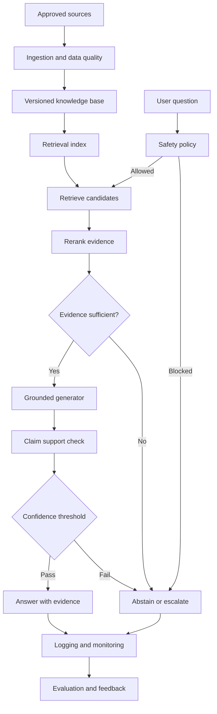

# Hallucination-Aware Diabetes GenAI

An industry-style GenAI/LLMOps research prototype for evidence-grounded diabetes knowledge support with explicit abstention.

**Research and education only.** This system is not a medical device or a clinically validated tool. Do not use it for diagnosis, prescribing, individualized medication or insulin dosing, device settings, or emergency decisions. Do not enter real patient information.

## Architecture



## Implemented in this repository

- Approved-source registry, local text ingestion, cleaning, chunking, quality checks and knowledge-base fingerprints.
- CPU-friendly retrieval combining TF-IDF cosine similarity and exact-term overlap; optional cross-encoder reranking.
- Extractive demo generation and optional CUDA Phi-3 PEFT adapter inference; optional original normalized Sentence-BERT/FAISS index loading.
- Rule-based safety policy, evidence sufficiency gate, lexical claim-support checks, heuristic weighted confidence and risk-specific thresholds.
- FastAPI service, Streamlit user interface and operations dashboard, SQLite interaction and feedback persistence.
- Dataset versioning, local experiment and model registry utilities, refresh-age checks, subgroup evaluation, drift calculation and PHI-pattern redaction utilities.
- Docker configuration, automated tests and CI workflow.

## Quick start

Python 3.11 is recommended. Run from the repository root.

```bash
git clone https://github.com/mansibhosle/hallucination-aware-diabetes-genai.git
cd hallucination-aware-diabetes-genai
python -m venv .venv
# Linux/macOS: source .venv/bin/activate
# Windows PowerShell: .venv\Scripts\Activate.ps1
python -m pip install -r requirements.txt
python scripts/bootstrap_demo.py
uvicorn src.api.main:app --port 8000
```

In a second terminal, activate the same environment and run:

```bash
streamlit run src/ui/streamlit_app.py
```

Operations dashboard (optional):

```bash
streamlit run src/ui/admin_dashboard.py --server.port 8502
```

API documentation is served at http://localhost:8000/docs.

### Example questions

- What is prediabetes?
- Why is foot care important in diabetes?
- How many units of insulin should I take? (expected abstention)
- Which stock should I buy? (expected abstention)

### Tests and demo evaluation

```bash
pytest -q
python -m src.evaluation.run_eval --file data/evaluation/sample_eval.jsonl
```

The four-question demo checks answer/abstain behavior only. It is not a measure of clinical correctness or a reliable estimate of hallucination rates.

## Research background

The preceding academic capstone investigated domain-adapted Phi-3 Mini, Sentence-BERT/FAISS retrieval over 2,335 diabetes-related chunks, and confidence-based abstention. In that separate experiment, the 78-question held-out test produced 79.49% end-to-end accuracy, 87.50% evidence support, and a reduction in evidence-based hallucination from 19.23% (RAG alone) to 12.50% (full system). Abstention recall was 40%; results were not independently clinically validated.

These historical results are **not results of this repository's lightweight demo**. The original trained adapter, full corpus, vector index and research evaluation files are not included. An optional integration backend is included; runtime validation with the private artifacts and an independent evaluation of the changed system are still required.

## Configuration and production roadmap

See .env.example, ARCHITECTURE.md and PROJECT_ROADMAP.md.

The default implementation uses TF-IDF, lexical overlap, extractive generation and heuristic confidence. Optional FAISS and PEFT backend code is included. Experimental NLI verification is available; learned confidence calibration, full evaluation, authentication, automated source ingestion and managed cloud deployment require additional engineering. Some lifecycle utilities are standalone and not wired into the serving path.

Select the phi3_peft backend explicitly to load the local adapter. See the GPU configuration below. The source registry is an example policy, not legal clearance for redistributing every document. Verify individual document licenses before ingestion or redistribution.

Do not expose this unauthenticated prototype to public traffic or submit real patient data. The SQLite logger stores raw inputs; the PHI utility is not comprehensive or automatically applied to the API.

## Repository layout

| Path | Purpose |
|---|---|
| src/data | Ingestion, quality and versioning |
| src/retrieval | Retrieval, reranking and query normalization utility |
| src/generation | Generator interface |
| src/verification | Claim-support heuristic |
| src/safety | Safety policies |
| src/confidence | Weighted scoring |
| src/training | Dataset, experiment and model metadata |
| src/evaluation | Smoke evaluation, metrics and subgroup utilities |
| src/monitoring | Monitoring and drift utilities |
| src/governance | Source registry and audit utility |
| src/security | Pattern-based PHI utility |
| src/orchestration | Knowledge refresh helpers |
| src/api, src/ui | FastAPI and Streamlit |
| scripts, configs, tests | Bootstrap, configuration and testing |

Generated indexes, runtime databases, local model weights and secrets are excluded from version control.

## Optional GPU capstone mode

Install requirements-gpu.txt on a CUDA-enabled machine. Set the following environment variables to private local artifact paths (do not commit the artifacts):

```dotenv
GENERATION_BACKEND=phi3_peft
MODEL_ADAPTER_PATH=/path/to/phi3_diabetes_sft_adapter
EMBEDDING_BACKEND=faiss
FAISS_INDEX_PATH=/path/to/guidelines.faiss
FAISS_METADATA_PATH=/path/to/metadata.json
FAISS_BUILD_INFO_PATH=/path/to/build_info.json
GUIDELINE_CHUNKS_PATH=/path/to/guideline_chunks.jsonl
EMBEDDING_DEVICE=cpu
TOP_K_CANDIDATES=5
TOP_K_FINAL=5
RERANK_BACKEND=heuristic
DB_PATH=outputs/capstone_smoke.sqlite
```

Run `python scripts/smoke_capstone.py`. Startup checks all metadata IDs and texts against the original corpus, index dimensions and metric, and compares a sample of reconstructed vectors with newly encoded records. The GPU backend loads the base Phi-3 model in 4-bit NF4 and the supplied final SFT adapter. The original adapter, index and data must be supplied separately. The current lexical claim verifier and risk thresholds differ from the original capstone evaluation; these are heuristic checks, not clinically validated safety controls. GPU smoke tests and full evaluation must be run with the private artifacts; CI tests metadata validation without downloading models.


### Experimental retrieval reliability upgrade

For the next research smoke test, select `FAISS_SEARCH_MODE=hybrid`, `TOP_K_CANDIDATES=30`, `TOP_K_FINAL=5`, `RERANK_BACKEND=cross_encoder`, and `RERANK_DEVICE=cpu`. This combines dense and BM25 ranks using reciprocal rank fusion, conservatively excludes likely bibliography chunks, and reranks the candidate passages with a general-purpose cross-encoder. The evidence gate still uses dense cosine similarity, not raw cross-encoder logits. The model's generation budget defaults to 160 tokens; hitting the budget without an EOS token now produces an explicit abstention. These changes are experimental, not clinically validated, and must be evaluated on independent questions. Claim verification defaults to lexical similarity; an optional experimental NLI backend is described below. Source dates and clinical relevance still require review.


### Experimental NLI verification

Set `VERIFICATION_BACKEND=nli` with the GPU research configuration. The default NLI model is cross-encoder/nli-deberta-v3-small on CPU. It compares each generated sentence (hypothesis) against each retrieved passage (premise) using entailment, contradiction and neutral labels. A sentence requires at least one entailment score >= 0.80 and no contradiction score >= 0.80. Any unsupported sentence causes ABSTAIN_NLI. Thresholds are uncalibrated starting points; sentence splitting is not atomic claim extraction, and the model is general-domain rather than clinically validated. NLI establishes estimated textual support, not truth, source currency, clinical appropriateness or completeness. Contradiction checks may cause false abstentions. Review source quality and test on independent data before deployment. Unit tests use synthetic scores and do not validate actual NLI model accuracy. Keep private artifacts and evaluation logs outside Git.


### Experimental hierarchical retrieval

Set `FAISS_SEARCH_MODE=hierarchical` to build an additional in-memory index of overlapping one- and two-sentence windows (long spans are split into bounded word windows). Child dense and BM25 rankings are deduplicated by original parent and fused; the cross-encoder ranks the best dense-matching child window. The full original parent passage is returned for generation and verification with source metadata and a matched-window diagnostic. No original FAISS artifacts are overwritten and no child vectors or medical documents are committed. Building the child index adds startup time and memory consumption.

Example retrieval-only diagnostic (private artifacts must be configured):

```bash
python scripts/diagnose_retrieval.py --question "What is prediabetes?" --mode hierarchical --candidates 100
```

The evidence gate uses child-window cosine rather than parent cosine in this mode. Although the numeric threshold is unchanged, the score distribution is not comparable and requires fresh validation. This is an experimental retrieval option, not evidence of improved clinical accuracy. The existing semantic/hybrid modes remain available. The new unit tests validate window creation and parent deduplication, not actual medical retrieval quality.


### Retrieval benchmark (validation only)

With the private artifacts configured, run:

```bash
python scripts/benchmark_retrieval.py --evaluation /private/path/evaluation_questions.csv --candidates 100
```

Compares original dense FAISS, hybrid RRF, hybrid with cross-encoder and hierarchical with cross-encoder. All use the same candidate budget and top-five evaluation cutoff. The original validation split is selected by name; the test split is not used. Questions labeled should_abstain are excluded from this retrieval relevance benchmark and reported in exclusions.json. Missing/unmapped reference source IDs cause a clear failure rather than silently biasing the comparison. Results are saved to ignored outputs/retrieval_benchmark (summary.csv, per_question.csv, exclusions.json, manifest.json). No Phi-3 or NLI inference is needed.

Hit@1/5 and MRR@5 are based on matching reference source IDs at ranked passage positions; source recall counts distinct labeled sources retrieved. They are **source-level proxies**, not passage-level relevance or medical factual accuracy. Review top-five passages for actual clinical relevance before selecting a configuration. Mean and p95 retrieval latency include reranking where applicable; initialization is reported separately. A small validation set gives noisy estimates, and previously inspected examples are development cases. Use an independent held-out evaluation after fixing the configuration.


## Final evaluation and MLflow

Complete the validation retrieval benchmark first. Review retrieved passage relevance and latency. Run:

```bash
python scripts/evaluate_system.py --evaluation /private/path/evaluation_questions.csv --split validation --output-dir outputs/final_validation
```

The provisional selection uses source MRR@5, then Hit@5, then lowest mean latency; use --configuration to override based on reviewed evidence. Automatic metrics measure abstention and latency only. Copy review.csv to reviewed.csv and fill factual_correct, evidence_supported, safe_under_review_rubric with reviewed 0/1 for every ANSWER. Run:

```bash
python scripts/score_review.py --run-dir outputs/final_validation --review outputs/final_validation/reviewed.csv
pip install -r requirements-mlops.txt
python scripts/log_mlflow.py --run-dir outputs/final_validation
mlflow ui --backend-store-uri sqlite:///outputs/mlflow.db --host 127.0.0.1 --port 5000
```

Keep all review files private. MLflow logs aggregate metrics and fingerprints, not raw evidence. Do not expose MLflow publicly. Freeze an explicit configuration before rerunning the historical test using --split test --configuration NAME --allow-original-test and a new output directory. This is not a new independent test; independent evaluation and clinician review remain necessary. Undefined rates are null.
