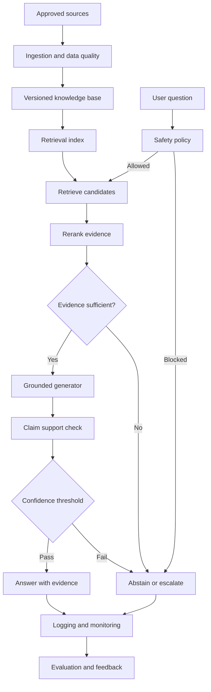

# Hallucination-Aware Diabetes GenAI

An industry-style GenAI/LLMOps research prototype for evidence-grounded diabetes knowledge support with explicit abstention.

**Research and education only.** This system is not a medical device or a clinically validated tool. Do not use it for diagnosis, prescribing, individualized medication or insulin dosing, device settings, or emergency decisions. Do not enter real patient information.

## Architecture



## Implemented in this repository

- Approved-source registry, local text ingestion, cleaning, chunking, quality checks and knowledge-base fingerprints.
- CPU-friendly retrieval combining TF-IDF cosine similarity and exact-term overlap; optional cross-encoder reranking.
- Extractive evidence-grounded demo generator; optional Hugging Face base-model text generation.
- Rule-based safety policy, evidence sufficiency gate, lexical claim-support checks, heuristic weighted confidence and risk-specific thresholds.
- FastAPI service, Streamlit user interface and operations dashboard, SQLite interaction and feedback persistence.
- Dataset versioning, local experiment and model registry utilities, refresh-age checks, subgroup evaluation, drift calculation and PHI-pattern redaction utilities.
- Docker configuration, automated tests and CI workflow.

## Quick start

Python 3.11 is recommended. Run from the repository root.

```bash
git clone https://github.com/mansibhosle/hallucination-aware-diabetes-genai.git
cd hallucination-aware-diabetes-genai
python -m venv .venv
# Linux/macOS: source .venv/bin/activate
# Windows PowerShell: .venv\Scripts\Activate.ps1
python -m pip install -r requirements.txt
python scripts/bootstrap_demo.py
uvicorn src.api.main:app --port 8000
```

In a second terminal, activate the same environment and run:

```bash
streamlit run src/ui/streamlit_app.py
```

Operations dashboard (optional):

```bash
streamlit run src/ui/admin_dashboard.py --server.port 8502
```

API documentation is served at http://localhost:8000/docs.

### Example questions

- What is prediabetes?
- Why is foot care important in diabetes?
- How many units of insulin should I take? (expected abstention)
- Which stock should I buy? (expected abstention)

### Tests and demo evaluation

```bash
pytest -q
python -m src.evaluation.run_eval --file data/evaluation/sample_eval.jsonl
```

The four-question demo checks answer/abstain behavior only. It is not a measure of clinical correctness or a reliable estimate of hallucination rates.

## Research background

The preceding academic capstone investigated domain-adapted Phi-3 Mini, Sentence-BERT/FAISS retrieval over 2,335 diabetes-related chunks, and confidence-based abstention. In that separate experiment, the 78-question held-out test produced 79.49% end-to-end accuracy, 87.50% evidence support, and a reduction in evidence-based hallucination from 19.23% (RAG alone) to 12.50% (full system). Abstention recall was 40%; results were not independently clinically validated.

These historical results are **not results of this repository's lightweight demo**. The original trained adapter, full corpus, vector index and research evaluation files are not included. Integrating those artifacts and evaluating the changed system on an appropriate independent test set is future work.

## Configuration and production roadmap

See .env.example, ARCHITECTURE.md and PROJECT_ROADMAP.md.

The default implementation uses TF-IDF, lexical overlap, extractive generation and heuristic confidence. Actual Sentence-BERT/FAISS integration, trained PEFT adapter loading, NLI verification, learned confidence calibration, full evaluation, authentication, automated source ingestion and managed cloud deployment require additional engineering. Some lifecycle utilities are standalone and not wired into the serving path.

The optional Transformers generator can load a base model after installing its dependencies; setting an adapter path alone does not load an adapter in this version. The source registry is an example policy, not legal clearance for redistributing every document. Verify individual document licenses before ingestion or redistribution.

Do not expose this unauthenticated prototype to public traffic or submit real patient data. The SQLite logger stores raw inputs; the PHI utility is not comprehensive or automatically applied to the API.

## Repository layout

| Path | Purpose |
|---|---|
| src/data | Ingestion, quality and versioning |
| src/retrieval | Retrieval, reranking and query normalization utility |
| src/generation | Generator interface |
| src/verification | Claim-support heuristic |
| src/safety | Safety policies |
| src/confidence | Weighted scoring |
| src/training | Dataset, experiment and model metadata |
| src/evaluation | Smoke evaluation, metrics and subgroup utilities |
| src/monitoring | Monitoring and drift utilities |
| src/governance | Source registry and audit utility |
| src/security | Pattern-based PHI utility |
| src/orchestration | Knowledge refresh helpers |
| src/api, src/ui | FastAPI and Streamlit |
| scripts, configs, tests | Bootstrap, configuration and testing |

Generated indexes, runtime databases, local model weights and secrets are excluded from version control.
